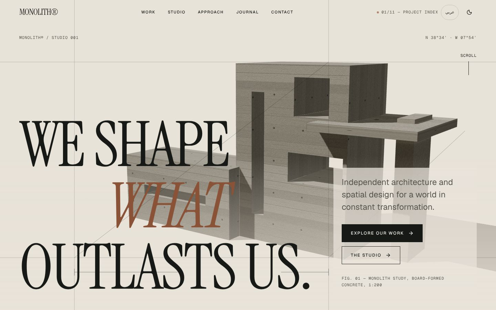
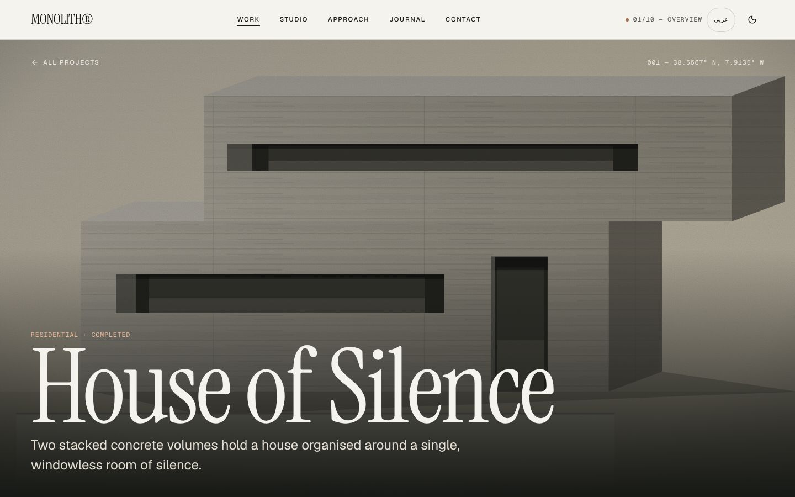
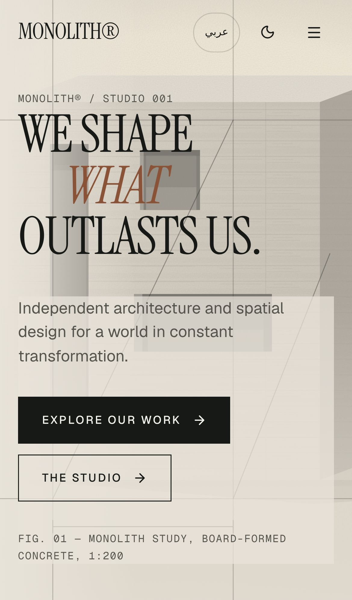
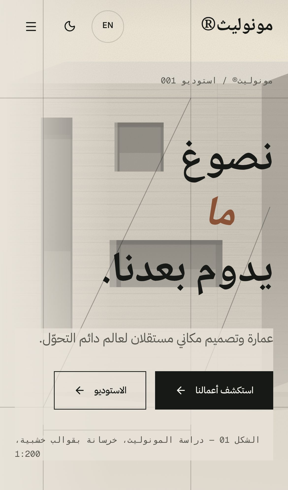
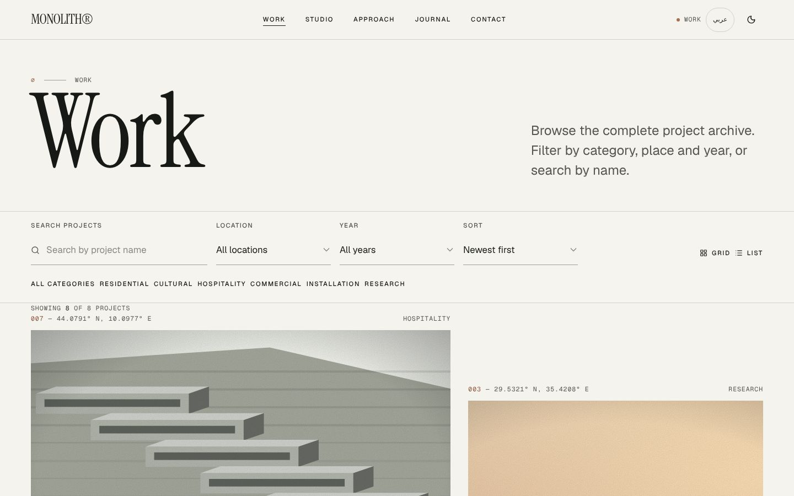

<div align="center">

# MONOLITH®

**An experimental, bilingual (EN / AR) architecture-studio website with a real-time 3D hero — built as a front-end portfolio piece.**

[](https://github.com/Eslamraafat1/3D-Website-/actions/workflows/ci.yml)


[](https://3-d-website-seven-xi.vercel.app)
[](LICENSE)

[**Live Demo**](https://3-d-website-seven-xi.vercel.app) · [**Portfolio**](https://new-portfolio-ashy-xi.vercel.app) · [**LinkedIn**](https://www.linkedin.com/in/eslamraafat-dev/)



</div>

---

## Overview

MONOLITH® is a **fictional** independent architecture and spatial-design studio. The studio, its people, clients, projects, figures and contact details are invented demo content — the site says so on the pages themselves (footer, studio, contact) and in its structured data.

What *is* real is the front-end engineering: a fully bilingual English / Arabic (RTL) site on the Next.js 16 App Router with Cache Components, a lazy-loaded React Three Fiber hero, scroll-driven GSAP storytelling, an interactive floor-plan viewer, a filterable project archive, an accessible inquiry form, technical SEO, and an end-to-end test suite that runs in CI against a local production build.

## Screenshots

| Desktop — case study | Mobile — home | Mobile — Arabic (RTL) |
| --- | --- | --- |
|  |  |  |

<details>
<summary>Project archive (desktop)</summary>


</details>

## Key Features

**3D & motion**
- Real-time **React Three Fiber** hero: a procedurally textured board-formed-concrete monolith (canvas-generated texture, extruded geometry). Loaded with `next/dynamic` (`ssr: false`), only on wide, fine-pointer screens with WebGL; otherwise a procedural SVG fallback is shown. The render loop stops (`frameloop="never"`) when the hero is off-screen.
- **GSAP + ScrollTrigger** scroll storytelling: pinned horizontal project reel, a blueprint that draws itself in stages, parallax and scrubbed text fills.
- **Framer Motion** for layout transitions in the archive, mobile menu, gallery lightbox and floor-plan details.
- Page-transition "ink curtain", custom desktop cursor with magnetic buttons, reading-progress bar.

**Content & interaction**
- **Work archive** (8 projects): search, category / location / year filters, sort, grid ↔ list view — all mirrored in the URL so any view can be shared.
- **Case studies**: concept, challenges/solutions, keyboard-navigable image lightbox, **interactive floor plan** (levels, zoom, room selection), material palette, count-up metrics, team, previous/next.
- **Journal** with category filter and search; article pages with Web Share / copy-link.
- **Inquiry form** with client-side validation, an error summary that receives focus, per-field `aria-invalid` / `aria-describedby`, and a success state. It is a **mock** — nothing is sent anywhere (see `lib/services/inquiry.ts`).

**Bilingual & accessible**
- Every string is typed `{ en, ar }`; Arabic pages render server-side with `lang="ar" dir="rtl"`, Arabic fonts and Arabic-Indic numerals.
- The language switch keeps the current page and is remembered in a cookie; `proxy.ts` sends unprefixed URLs to the visitor's language.
- Skip link, visible focus styles, labelled icon buttons, light/dark theme without a flash (pre-paint script).
- **`prefers-reduced-motion` is respected everywhere**: no 3D canvas, no pinned/scrubbed GSAP sections, no curtain or marquee, reveals shown immediately, Framer Motion transitions disabled.

## Tech Stack

| Area | Technology |
| --- | --- |
| Framework | Next.js 16.4.3 (App Router, Cache Components, Partial Prerendering, `proxy.ts`) |
| UI | React 19.3, TypeScript 5, Tailwind CSS 4 |
| 3D | three 0.186, @react-three/fiber 9 |
| Animation | GSAP 3.15 + ScrollTrigger, Framer Motion |
| Icons / fonts | lucide-react, `next/font` (Geist, Instrument Serif, IBM Plex Sans Arabic, Noto Naskh Arabic) |
| Testing | Playwright 1.48 (desktop Chrome + Pixel 7 projects) |
| CI / hosting | GitHub Actions, Vercel |

## Architecture Highlights

- **Cache Components / PPR** (`cacheComponents: true`): every page, plus all 24 project and article routes (12 slugs × 2 locales), is prerendered via `generateStaticParams`; only client-state islands (e.g. the archive's search params, wrapped in `<Suspense>`) stream.
- **`proxy.ts`** (Next 16's replacement for `middleware.ts`): redirects unprefixed paths to `/en` or `/ar` (cookie → `Accept-Language`), keeping path and query string, and answers unknown project/article slugs with a **404** status.
- **Typed content + service layer**: `lib/data` holds typed bilingual content; `lib/services/content.ts` exposes async functions returning serialisable view models, so a CMS or API could replace it without touching the UI.
- **3D strategy**: the WebGL scene is code-split and client-only, gated by `matchMedia` (width, fine pointer, reduced motion) and a one-off WebGL probe, wrapped in an error boundary, with a capped device-pixel ratio (`dpr={[1, 1.6]}`). All other imagery is **procedural SVG** (`components/art/ArchArt.tsx`) — the site ships no raster images.

## SEO & Performance

- Per-page `generateMetadata`: title template, description, **absolute canonical**, **hreflang** (`en`, `ar`, `x-default`), Open Graph and Twitter cards.
- Generated **Open Graph / Twitter image** (`app/[lang]/opengraph-image.tsx`, 1200×630, built statically).
- `sitemap.xml` (36 URLs: every page in both languages, with hreflang alternates) and `robots.txt`.
- **JSON-LD**: `Organization` + `ProfessionalService` (explicitly marked fictional — no address, phone or geo data) and `WebSite` site-wide; `CreativeWork` + `BreadcrumbList` on case studies; `BlogPosting` + `BreadcrumbList` on journal articles.
- The site URL resolves from `NEXT_PUBLIC_SITE_URL` → `VERCEL_PROJECT_PRODUCTION_URL` → the production URL, so canonical and sitemap URLs can never point to localhost.
- Unknown URLs render a styled, localised, `noindex` not-found page.
- Static prerendering, self-hosted fonts via `next/font`, lazy-loaded 3D, no raster images.

## Testing & QA

An end-to-end suite lives in [`e2e/`](e2e) (its own `package.json` and lockfile). **35 tests** run on two Playwright projects — desktop Chrome (1440×900) and mobile (Pixel 7); viewport-independent SEO checks run on desktop only.

| Spec | Covers |
| --- | --- |
| `home.spec.js` | hero renders with **no console errors**, locale redirects (`/`, `/work`, `Accept-Language: ar`), primary navigation (desktop bar + mobile menu), theme toggle persists, skip link |
| `work.spec.js` | category / location filters and search update results **and the URL**, state restored on reload, empty state, list view sorted A–Z, opening a case study, previous/next, journal article |
| `contact.spec.js` | error summary + `aria-invalid` on empty submit, email / min-length validation, valid inquiry → success state with reference |
| `i18n.spec.js` | SSR `lang`/`dir` for EN and AR, language switch keeps the page and flips to RTL, language remembered, Arabic validation messages |
| `errors.spec.js` | 404 status + styled `noindex` page, unknown project slug, Arabic 404, **reduced motion** (no curtain, no WebGL canvas) |
| `seo.spec.js` | canonical / hreflang / OG URLs are absolute production URLs (never localhost), OG image is a 1200×630 PNG, JSON-LD types, `robots.txt`, `sitemap.xml` |

```bash
cd e2e && npm ci
npx playwright install chromium          # once
npm test                                 # against the live site
BASE_URL=http://localhost:3000 npm test  # against a local `npm run build && npm start`
```

**CI** (`.github/workflows/ci.yml`) runs on every push to `main` and every pull request: `npm ci` → lint → type-check → production build → start the build → Playwright suite against it, uploading the HTML report as an artifact.

## Project Structure

```
app/
  [lang]/                 # every route lives under /en or /ar
    layout.tsx            # <html lang dir>, fonts, theme boot script, site JSON-LD
    page.tsx              # home
    work/ · work/[slug]/  # archive + case studies
    journal/ · journal/[slug]/
    studio/ · approach/ · contact/
    [...rest]/            # unknown URLs → localised not-found
    not-found.tsx · error.tsx · template.tsx (page curtain)
    opengraph-image.tsx · twitter-image.tsx
  robots.ts · sitemap.ts
components/
  three/Hero3D.tsx        # R3F scene
  art/ArchArt.tsx         # procedural SVG imagery
  home/ work/ plan/ sections/ layout/ ui/
lib/
  data/                   # typed bilingual content (fictional)
  services/               # async content + mock inquiry service
  i18n/                   # locales, dictionaries, number formatting
  seo.ts · site.ts · hooks.ts · gsap.ts
proxy.ts                  # locale redirects + 404 status for unknown slugs
e2e/                      # Playwright suite (separate package)
```

## Getting Started

Requires **Node.js ≥ 20.9**.

```bash
git clone https://github.com/Eslamraafat1/3D-Website-.git
cd 3D-Website-
npm ci
npm run dev          # http://localhost:3000 → redirects to /en or /ar
```

| Script | Description |
| --- | --- |
| `npm run dev` | development server |
| `npm run build` / `npm start` | production build / serve it |
| `npm run lint` | ESLint (`eslint-config-next`) |
| `npm run typecheck` | `tsc --noEmit` |

Environment variables are optional — see [`.env.example`](.env.example) (`NEXT_PUBLIC_SITE_URL`).

## Deployment

Deployed on **Vercel** from `main`: <https://3-d-website-seven-xi.vercel.app>. No configuration is required: on Vercel the canonical URL comes from `VERCEL_PROJECT_PRODUCTION_URL` automatically. Set `NEXT_PUBLIC_SITE_URL` if you add a custom domain.

## Author

**Eslam Raafat** — Front-End Developer

- Portfolio: <https://new-portfolio-ashy-xi.vercel.app>
- LinkedIn: <https://www.linkedin.com/in/eslamraafat-dev/>
- GitHub: <https://github.com/Eslamraafat1>
- Email: <eslamraafat736@gmail.com>

## License

[MIT](LICENSE) © 2026 Eslam Raafat. MONOLITH® and all studio content are fictional.
